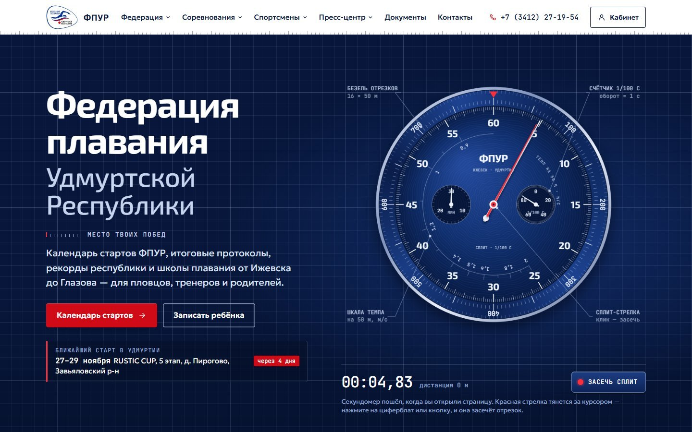
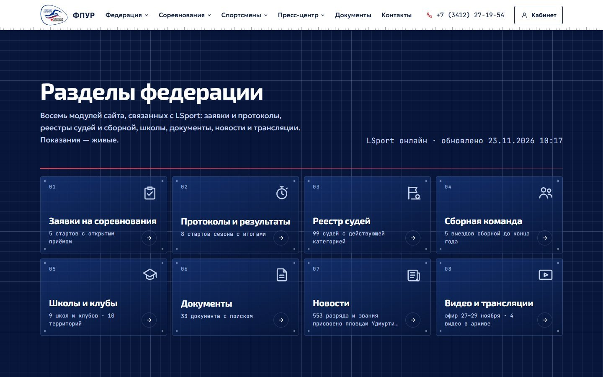
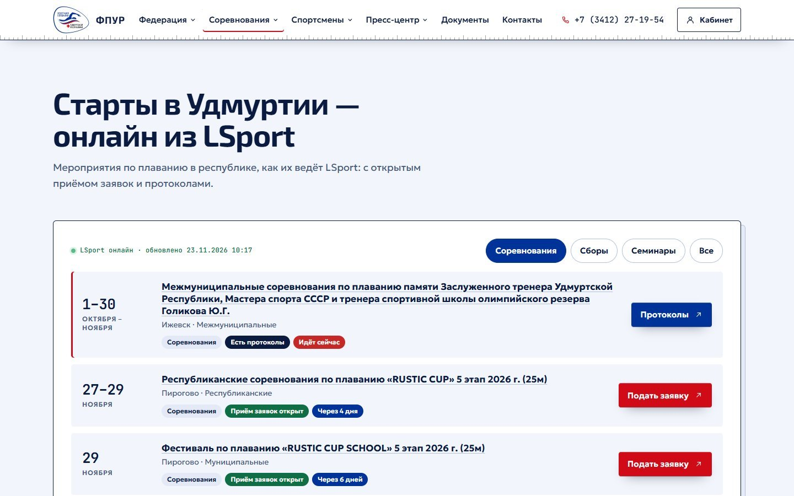
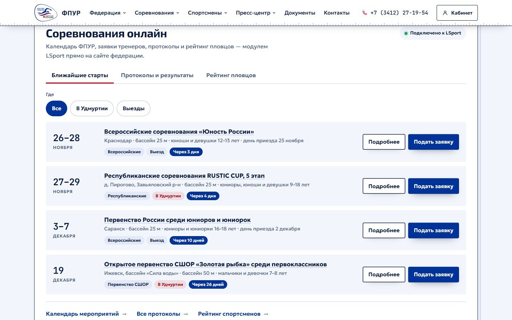
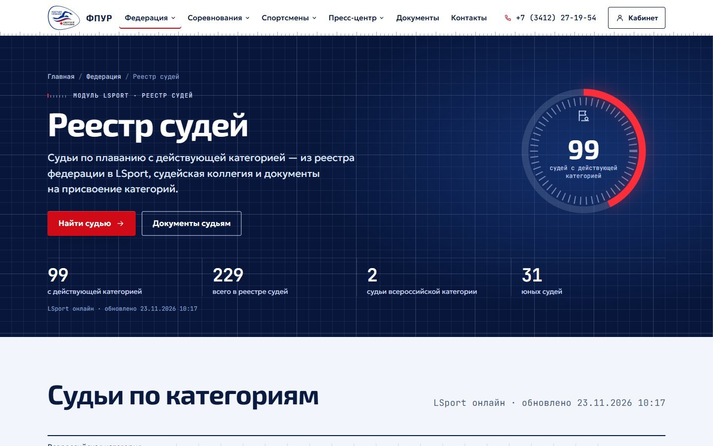
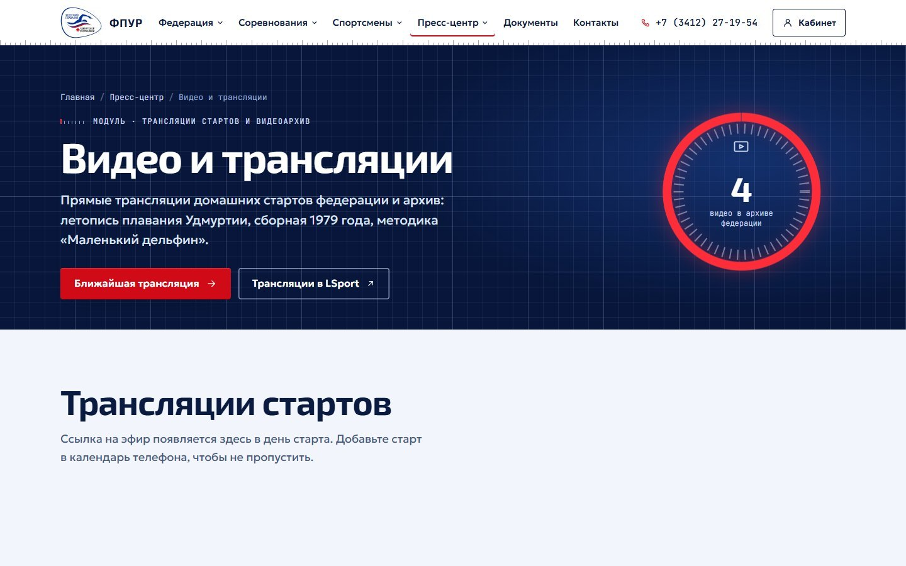
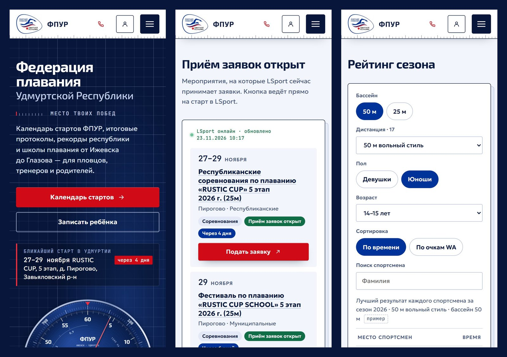

<div align="center">

# Федерация плавания Удмуртской Республики — новый сайт

**Дизайн «Хронометр» · модули LSport · демонстрационная версия для заказчика**

[**Открыть демо →**](https://vantegracode.github.io/vantegraxlsport1/)

<sub>Разработка — студия <a href="https://vantegracode.ru">Vantegra</a> · ноябрь 2026</sub>

</div>



Новый сайт РДМОО «Федерация плавания Удмуртской Республики» (сейчас — udm-swim.ru). Главная устроена как точный прибор: хронограф со сплит-стрелкой, шкалы, чертёжная сетка. Сайт связан с LSport, где федерация ведёт реестры и календарь: цифры, судьи, сборная и старты на сайте берутся оттуда и обновляются сами.

> Это демонстрационная версия для согласования с федерацией. Она закрыта от поисковиков (`noindex`) и не заменяет официальный сайт.

---

## Как смотреть

Сайт работает в любом современном браузере: на телефоне, планшете и компьютере. Разделы открываются по прямым ссылкам:

| Раздел | Ссылка |
|---|---|
| Главная | [открыть](https://vantegracode.github.io/vantegraxlsport1/) |
| Календарь мероприятий | [#/kalendar](https://vantegracode.github.io/vantegraxlsport1/#/kalendar) |
| Заявки на соревнования | [#/zayavki](https://vantegracode.github.io/vantegraxlsport1/#/zayavki) |
| Протоколы и результаты | [#/protokoly](https://vantegracode.github.io/vantegraxlsport1/#/protokoly) |
| Рейтинг спортсменов | [#/rejting](https://vantegracode.github.io/vantegraxlsport1/#/rejting) |
| Реестр судей | [#/sudi](https://vantegracode.github.io/vantegraxlsport1/#/sudi) |
| Сборная команда | [#/sbornaya](https://vantegracode.github.io/vantegraxlsport1/#/sbornaya) |
| Школы и клубы | [#/shkoly](https://vantegracode.github.io/vantegraxlsport1/#/shkoly) |
| Документы | [#/dokumenty](https://vantegracode.github.io/vantegraxlsport1/#/dokumenty) |
| Новости | [#/novosti](https://vantegracode.github.io/vantegraxlsport1/#/novosti) |
| Видео и трансляции | [#/video](https://vantegracode.github.io/vantegraxlsport1/#/video) |
| О федерации · Руководство · История · Контакты | [#/o-federacii](https://vantegracode.github.io/vantegraxlsport1/#/o-federacii) |

На главной попробуйте: проведите курсором по циферблату — красная стрелка тянется за ним, нажмите на циферблат — она засечёт сплит; прокрутка страницы поворачивает безель.

---

## Модули



| Модуль | Что делает | Данные |
|---|---|---|
| **Календарь мероприятий** | старты в Удмуртии из LSport с фильтром «соревнования / сборы / семинары» и календарь ФПУР с выездами сборной; у каждого старта своя страница с обратным отсчётом и файлом для календаря телефона | LSport онлайн + календарь ФПУР 2026 |
| **Заявки на соревнования** | старты, на которые LSport сейчас принимает заявки, — кнопка ведёт прямо на старт; как подать заявку, Entry Editor, аккредитации, бронь для команд | LSport онлайн |
| **Протоколы и результаты** | старты с опубликованными протоколами — ссылки на LSport; таблица результатов с фильтрами по 18 дистанциям, полу, возрасту и поиском | список — LSport онлайн, таблица — пример |
| **Рейтинг спортсменов** | лучшие результаты сезона: бассейн 25 / 50 м, 18 дистанций, сортировка по времени или очкам World Aquatics; возраст и разряды реестра | цифры — LSport онлайн, рейтинг — пример |
| **Реестр судей** | судьи с действующей категорией, поиск и фильтр, судейская коллегия, как получить категорию | LSport онлайн |
| **Сборная команда** | состав из реестра LSport (основной и резерв, по годам рождения), выезды сборной в сезоне | LSport онлайн |
| **Школы и клубы** | девять школ с адресами и картой, шкала спортсменов по территориям, запись ребёнка | сайт федерации + LSport онлайн |
| **Документы** | 33 документа в одном каталоге с поиском и разделами | сайт федерации |
| **Новости** | лента анонсов и итогов, страница новости | пример наполнения |
| **Видео и трансляции** | эфиры домашних стартов с обратным отсчётом, видеоархив федерации | сайт федерации |

Кнопки **«Подать заявку»**, **«Результаты»**, **«Рейтинг»**, **«Кабинет участника»** и **«Аккредитации»** вынесены на первый экран, вход в кабинет — ещё и в шапку на каждой странице.



### Живые данные LSport

При открытии сайт сам запрашивает у LSport открытые данные федерации — те же, что показывает её публичная страница на портале: показания реестра, разряды, судей, сборную и календарь региона. Цифры подписаны «LSport онлайн · обновлено …». Если портал недоступен, сайт показывает сохранённый снимок и честно подписывает его «снимок на …». Данные кэшируются на 10 минут, чтобы не нагружать LSport.

Для рабочей версии формат подключения согласуется с LSport; тогда же в таблицы результатов и рейтинга придут настоящие протоколы.

---

## Дизайн «Хронометр»



- **Образ — точная механика Ижевска.** Город инженеров: воронёная сталь, гравировка, шкалы. Плавание — это сплиты и сотые доли секунды, поэтому главный элемент — хронограф.
- **Цвета федерации.** Синий логотипа уходит в тёмную «воронёную» сталь, красный из знака Удмуртии — только сплит-стрелка, главные кнопки и отметка «сегодня».
- **Шрифты.** Exo 2 (заголовки), Geologica (текст), JetBrains Mono (показания и даты) — все с полной кириллицей.
- **Каждая страница — прибор.** В шапке раздела — шкала с главным показанием: 99 судей, 128 мероприятий, дни до старта.



### Анимации

- переход между страницами — стальная шторка с красной сплит-линией;
- заголовки выезжают из прорези, цифры докручиваются на барабанах одометров;
- дуга прибора в шапке раздела заполняется до показания, счётчики считают до значения;
- фотофиниш: щель проходит по кадру и проявляет фото;
- карточки, списки и строки таблиц появляются лесенкой, фильтры меняют список плавно;
- живой обратный отсчёт до ближайшего эфира и старта.

В режиме «уменьшить движение» (настройка системы) анимации отключаются, весь контент виден сразу.



### Телефоны и большие экраны

Вёрстка проверена автотестами на 22 разрешениях — от 320 px до 4K-телевизора: без горизонтальной прокрутки, текста за краем и мелких кнопок на сенсорных экранах.



---

## Что настоящее, а что пример

**Настоящее:** календарь ФПУР 2026, данные LSport (реестр, судьи, сборная, старты региона, ссылки на заявки и протоколы), школы, документы, руководство, судейская коллегия, история и видео — с сайта федерации и её страницы в LSport.

**Пример (помечено на страницах):** таблица результатов и рейтинг (имена и время условные), тексты новостей, формы записи и заявки — данные никуда не отправляются.

---

## Устройство

Сайт — один HTML-файл без сборки и сервера: стили, скрипты, GSAP и картинки встроены внутрь. Внутренние разделы открываются по адресам вида `#/раздел`.

```text
vantegraxlsport1/
├── index.html   # сайт целиком
├── README.md
└── docs/        # скриншоты для README
```

Внешние запросы: шрифты Google Fonts, данные LSport (`www.lsport.net`), видео YouTube — только по нажатию на ролик.

### Запуск у себя

```bash
git clone https://github.com/vantegracode/vantegraxlsport1.git
cd vantegraxlsport1
python -m http.server 8080
# открыть http://localhost:8080
```

Можно и просто открыть `index.html` в браузере.

---

<div align="center">

© 2026 [Vantegra](https://vantegracode.ru) · демонстрационная версия для Федерации плавания Удмуртской Республики

<sub>Данные спортсменов, судей и стартов принадлежат федерации и платформе LSport. Код и дизайн не распространяются по открытой лицензии.</sub>

</div>
